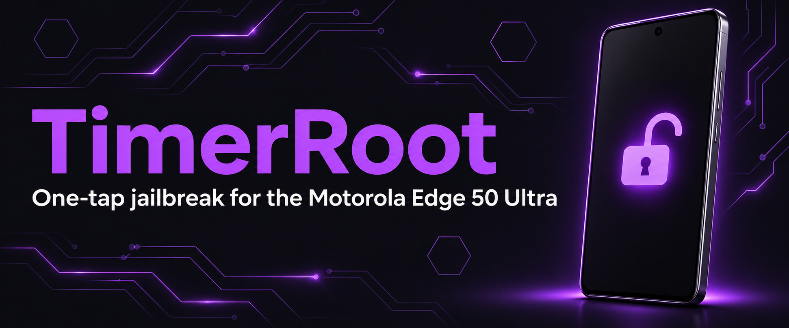

<p align="center">
  
</p>

<h3 align="center">One-tap root for the Motorola Edge 50 Ultra and its GKI family<br>— no bootloader unlock, no PC —</h3>

<p align="center">
  <a href="../../releases"></a>
  <a href="LICENSE"></a>
  <a href="https://shizuku.rikka.app/"></a>
  
</p>

## What is this?

TimerRoot turns the POSIX CPU timer use-after-free (**CVE-2026-98260**)
into a **one-tap root** for vivo, iQOO and Motorola phones: from the
Shizuku shell domain to uid 0, optionally handing root over to a
KernelSU-family manager (late-load of the manager's bundled `ksud` /
kernel module). Everything runs on the phone — no PC attached, and on
the Motorola Edge 50 Ultra no bootloader unlock either.

The vivo / iQOO models from the upstream tool are still supported; the
Edge 50 Ultra port adds every device running the same GKI kernel image
(see [Supported devices](#supported-devices)).

<details>
<summary><b>Upstream and naming</b></summary>

**Fork note:** this repository extends the upstream vivo/iQOO tool
(by Coolapk **@散花神木 (Sanhua Shenmu)**) with **Motorola Edge 50 Ultra**
support, an English UI and additional app-side safety features.

**Name note:** `kpgc10kai/TimerRoot`, referenced upstream, is a
different, older Pixel-rooting tool — this repository is unrelated
to it.

</details>

## Features

The app (`apk-gradle/` — Kotlin + Jetpack Compose, three tabs:
Home / Log / About; UI ported from
[Shark](https://github.com/Yunnijian/Shark), GPL-3.0):

- **One-tap jailbreak** with live stage display (`7/12 zero-write vr.ko`
  down to `Done` / `Failed`) — the button turns red and the status card
  shows **“Jailbreak active this boot”** live, no app restart needed;
- **Quiet-window preflight** before every run (load / boot age, fail-closed);
- ROOT manager dropdown with *Auto-detect* (see the
  [manager list](#root-managers)) and a **safe mode** switch — with safe
  mode checked, KSU modules stay disabled during the run (the manager's
  kernel module is still late-loaded);
- **One-run-per-boot lock**: reruns in the same boot are blocked with an
  explanation dialog; the guard is keyed to the kernel boot, so it
  survives framework restarts and in-place app updates (the run state
  is recovered automatically on the next launch);
- **Soft reboot - apply modules**: with root live, the home tab offers a
  framework restart (zygote) so Zygisk-style modules hook newly started
  processes without dropping the jailbreak;
- **Auto-opens**: after a successful run the ROOT manager opens
  automatically, with a "Root is live" notification covering the
  backgrounded case; when Shizuku is not running, the home tab offers
  an Open Shizuku button instead (the manual and log tabs work without
  it);
- **Readable log**: every line is time-stamped and color-coded (green
  proof / red failure / grey info), tapping a line copies it, the share
  button saves the log to Download (`TimerRoot-log-*.txt`) or the share
  sheet, a trash button clears it, and **run start / end banners** frame
  each attempt with its duration;
- **In-app updater**: checks GitHub for a newer release on start and on
  demand, shows the channel label next to the versions, and installs
  the downloaded APK only when its signature matches the installed app;
- **Direct install**: with the Shizuku service running, the updater
  installs a downloaded update silently through the shell service, the
  way `adb install` works — no confirmation dialog, no unknown-sources
  detour. If the shell install fails, the system installer opens as
  before;
- **What's new & beta channel**: release notes with tappable links — in
  the About tab and in the update dialog, where longer notes scroll
  under a versioned title ("What's new in <version>") with bold bullet
  lead-ins — plus a Beta channel switch that also picks up prereleases
  from the `nightly` line;
- **In-app manual**, clean-KSU and diagnostics; offset preflight
  (`ic-timer info`, read-only) with a missing-offsets dialog; parse
  offsets from `boot.img` or a full OTA package (zip64 + payload +
  zstd) with boot partition auto-extraction and device/version
  cross-checks.

The backend is a Shizuku user service (`IcService`); `IC_SYMS_FILE` /
`IC_SAFE_MODE` / `IC_KSU` behave as in the old 0.12 tool.

## Supported devices

Built-in offsets — model + firmware version match — no parsing required:

| Model | Versions |
| --- | --- |
| PD2506 / V2506 (Y500) | 16.1.15.0, 16.1.13.2, 16.1.17.0 |
| PD2516 / V2516 (Y500 Pro) | 16.1.11.0 |
| PD2307 / PD2329 / V2307 (iQOO 12) | 16.2.11, 16.2.20.3, 16.2.20.7, 16.2.21.1 |
| PD2417 / V2417 (Z9 Turbo+) | 16.2.14.1 |
| PD2324 / V2324 (X100 series) | 16.2.12.0, 16.2.13.1 |
| PD2352 / V2352 | 16.2.17.0 |
| PD2425 / V2425 | 16.1.17.10, 16.1.16.2 |
| DPD2329 / PD2329 | 16.2.9.2 |
| PD2339 / V2339 | 16.2.13.1 |
| PD2309 / V2309 | 16.2.15.0 |
| PD2445 / V2445 | 16.1.16.0 |
| Motorola Edge 50 Ultra (`ctwo`) | GKI `6.1.157-android14-11`, build `36e2a-a4560` (`CTWOMOTO` profile) |

Any other device running the **identical GKI image**
`6.1.157-android14-11-gb3d4cdadf339-ab16160610` (the full `uname -r`) is
built in as well — the banner alone pins the memory layout, regardless
of brand or model (v0.31+). Devices outside the list are not hard
blocked: the run is held for an explicit **out-of-scope confirmation**
(see [Safety rules](#safety-rules)).

### Parse offsets (builds outside the list)

Tap **Parse offsets** and pick the model's `boot.img` or a **full OTA
package (.zip)**:

- Full packages are extracted automatically (`payload.bin`, zip64 + zstd),
  and the image identity is checked against the phone: a mismatch is only
  fatal when the kernel banner differs - rebrands of the same OS build
  pass, and a different build with the same kernel banner proceeds;
- `init_boot` / `vendor_boot` contain no kernel and are refused;
- Kernel images other than 6.1.145 or 6.1.157 (Edge 50 Ultra GKI) are
  refused;
- On success `/data/local/tmp/ic-syms.txt` is generated — then run the
  one-tap jailbreak as usual.

For everything beyond that — a new device on a supported kernel
family, or a different kernel version entirely — see the
[porting guide](docs/porting.md).

### ROOT managers

The dropdown (and the handoff script) knows these managers — install one,
pick it or use *Auto-detect*:

KernelSU, KernelSU-Next, SukiSU Ultra, BakaSU, ReSukiSU (old package
name), SakiSU, FinaSU, 7kimisu (two package ids), vivoKSU.

## Requirements

- A supported phone (see [Supported devices](#supported-devices)) —
  a listed vivo / iQOO / Motorola model, or any device running the
  identical GKI image; for other builds have the firmware's `boot.img`
  or a full OTA package ready for
  [parse-offsets](#parse-offsets-builds-outside-the-list);
- [Shizuku](https://shizuku.rikka.app/) (Play Store or GitHub), started
  **on-device via Wireless debugging** — it must be restarted this way
  after every reboot — and the Shizuku permission granted to TimerRoot;
- Optional: a [KernelSU-family manager](#root-managers) installed.
  Without a manager the run still escalates to shell-domain uid 0 and
  prints the proof — it just does not hand root over to a manager;
- No PC attached, and on the Motorola Edge 50 Ultra no bootloader
  unlock.

## How to use

### 1. Install

- Download the APK from the [Releases](../../releases) page (built
  automatically for every `v*` tag), or build it from source (see
  [Build](#build)).
- Install [Shizuku](https://shizuku.rikka.app/) (Play Store or GitHub) and
  start it **on-device via Wireless debugging** (Developer options →
  Wireless debugging → pair, then start). Shizuku must be restarted this way
  after every reboot — when TimerRoot notices that Shizuku is not running,
  it shows an Open Shizuku button on the home tab (the manual and log tabs
  work without it).
- Grant TimerRoot the Shizuku permission.
- Optional: install a **ROOT manager** and pick it in the app's dropdown
  (see the [manager list](#root-managers)).
- If your model is not in the [supported list](#supported-devices),
  get the firmware's `boot.img` or a full OTA package ready and see
  [Parse offsets](#parse-offsets-builds-outside-the-list).

### 2. Run

1. **Reboot the phone.** A fresh boot is required before every full run —
   the exploit consumes its one-shot state per boot.
2. Open TimerRoot, pick the ROOT manager (or leave it on
   *Auto-detect*), and tap **One-tap jailbreak**.
3. A preflight check warns when the system is not quiet — 1-min load
   ≥ 6, boot younger than 150 s, or the load could not be measured —
   and asks you to wait. A quiet window measurably improves the
   success rate.
4. The button shows the live stage (e.g. `7/12 zero-write vr.ko`) and
   ends on `Done` / `Failed`.

### 3. What success looks like

- The status card shows **“Jailbreak active this boot”** (live, no app
  restart needed) and the button turns red;
- The log contains the root proof (`LPE-PROOF`, `uid=0(root)`, and — with a
  manager — `module resident`);
- The ROOT manager **opens automatically** after the run and shows
  **Working — Jailbreak mode**;
- A **“Root is live”** notification appears when the run finishes (tap it
  to open the manager);
- SELinux is back to enforcing after the run.

Root lives until the next reboot. **One run per boot**: after a run the
button switches to “Reboot required (already ran)”, and a second attempt
in the same boot cannot succeed (leftover core processes cannot be
`kill -9`'d; only a reboot clears them).

Modules that only hook newly started processes (Zygisk-style) do not
need a full reboot after installation: with root live, the home tab's
**Soft reboot - apply modules** button restarts the Android framework
alone - the kernel keeps running, so root and the jailbreak stay
alive.

The run lock is keyed to the **kernel boot**, not the Android
framework: a soft reboot does not re-arm the run button, and after an
in-place app update the app recovers the run state on its own when it
reopens.

## Safety rules

- **One run per boot.** Reboot the phone before every full run — the
  exploit consumes its one-shot state per boot, and after a run a
  second attempt in the same boot cannot succeed (leftover core
  processes cannot be `kill -9`'d). The lock is keyed to the kernel
  boot: a soft reboot does not re-arm the button.
- **Quiet system.** The preflight warns when the 1-min load is ≥ 6, the
  boot is younger than 150 s or the load could not be measured — wait
  for the quiet window, it measurably improves the success rate.
- **Never power off during a soft reboot.** The framework restart keeps
  the jailbreak alive exactly because the kernel keeps running; powering
  off clears root until the next one-tap run.
- **Back up before running** and keep a recovery path (stock `boot.img`
  or a full OTA). On an untested build a failure normally shows up as
  `fork/exec errno=12` (ENOMEM) rather than a kernel panic, but a panic
  on an unknown offset set cannot be fully ruled out. Devices outside
  the supported list run only after an explicit out-of-scope
  confirmation — privilege escalation will most likely fail on an
  unknown kernel.

## Verification

- QEMU (iQOO 12 6.1.145 image): shell path `ROOT_SHELL_OK`; fake path
  `uid=0 euid=0` + payload execution;
- Real devices: PD2329 / PD2307 / PD2425 shell-domain uid 0; PD2425
  `late-load rc=0`, kernelsu module resident;
- Motorola Edge 50 Ultra (`ctwo`): uid 0 proof + KernelSU-Next late-load,
  `kernelsu` module resident (bootloader locked);
- A second GKI-image device (Xiaomi 14T, out-of-scope confirm flow):
  out-of-the-box run, module resident, manager working in jailbreak
  mode.

## Edge 50 Ultra port (this fork)

Extends the tool to the **Motorola Edge 50 Ultra** (`ctwo`): Android 17
userspace on a stock, **bootloader-locked** GKI kernel
`6.1.157-android14-11`. What changed:

- **`CTWOMOTO` profile** in `core/profiles.h`: static addresses,
  cred/slab geometry and the rmtfs ioctl call-site data for the Motorola
  GKI build, plus built-in offsets (`ctwo_4220_links`) — the verified
  build works straight after a factory reset, no `ic-syms.txt` needed;
- **Direct late-load payload**: the payload drives the KernelSU late-load
  itself (`ksud late-load --kmi android14-6.1 --allow-shell`) and clears
  stale `/data/adb/ksud` state first, so the manager's Superuser tab no
  longer hangs after a run (KernelSU-Next #1716 workaround);
- **Proof-marker success detection**: a run counts as successful once the
  root-proof markers appear (`uid=0(root)`, `LPE-PROOF`, module resident);
- **English UI**, launcher name **TimerRoot**.

Verified on device: shell → uid 0 proof, then the KernelSU-Next manager
**“Working [Jailbreak mode]”** via late-loaded GKI LKM — no bootloader
unlock required.

## How it works

The core (`core/timer98260.c`, static C99, no root needed at start):

1. **Trace oracle** — the de-tagged `__tracepoint_sys_exit` address is
   derived from the timer call site: on 6.1, `do_timer_create` sits at an
   image offset < 2 MiB and the KASLR slide is 2 MiB-aligned, so
   `slide = site0 - (0xffffffc008000000 + low21)` — no kallsyms needed;
   when kallsyms is readable the absolute address is used directly;
2. **Cred leak → page spray → hit read-back → write primitive**;
3. **Shell or KSU endgame** — shell-domain uid 0 with proof commands, or
   a fake-cred full-caps root that hands over to the ROOT manager
   (`ksu_handoff.sh`, `ksu` mode).

Per-kernel constants live in `core/profiles.h` (selected via
`-DIC_PROFILE_*`); anchor tables in `core/anchors.h`; the object symbols
needed for fake cred in `core/extra_syms.h` (exact values for verified
builds — including the Edge 50 Ultra GKI 6.1.157, where the layout
differs from the vivo builds — take precedence over the derived ones).
The exploit writes, then **verifies** (read-back of uid, peek protocol on
the fake path) and retries on a miss (≤ 8 times).

## Discussion & support

- **Questions, feedback, device reports:** post in the
  [XDA discussion thread](https://xdaforums.com/t/tool-timerroot-one-tap-root-for-motorola-edge-50-ultra-no-bootloader-unlock-vivo-iqoo.4808957/) —
  that's the preferred place; I check it regularly and other users can help there too.
- **Bugs in the app or core:** open a
  [GitHub issue](https://github.com/xxTurborocketxx/TimerRoot/issues)
  with the app log (`/sdcard/Download/TimerRoot-log-*.txt` or `ic-app-*.log`) attached.
- **Porting to another device:** see the
  [porting guide](docs/porting.md) — requirements, the no-build
  parse-offsets path and what a full kernel port takes.

For anything else (usage help, other firmware builds, feature ideas), the XDA
thread is the better place — issues are mainly for reproducible bugs.

## Known limitations

- Filesystem layout and `struct cred` offsets of untested builds are
  derived from known builds; on an untested build a failure normally
  shows up as `fork/exec errno=12` (ENOMEM) rather than a kernel panic,
  but a panic on an unknown offset set cannot be fully ruled out;
- Upstream profiles fit 6.1.145 kernels; this fork adds the Edge 50
  Ultra's 6.1.157 GKI build;
- One run per boot; a second attempt in the same boot is refused.

<details>
<summary><b>Repo layout</b></summary>

| Path | Purpose |
| --- | --- |
| `apk-gradle/` | TimerRoot app (Gradle / Kotlin / Compose). Shizuku user service `IcService`; assets: `ic-timer` core binary, `run_core.sh`, `ksu_handoff.sh`, `safemode.sh`, `cleanup.sh`, manual |
| `core/` | The 98260 core: `timer98260.c` (main body), `profiles.h` / `anchors.h` / `extra_syms.h`, `ic_syms.c` (on-device symbol parser), `tools/` host-side generators, `build.sh` (NDK) |
| `tool/` | Host-side helpers: `kallsyms_py.py`, `parse_offsets.py`, `syms_host.c`, patched aircompressor sources |
| `device/` | Device-side development scripts (manual runs, offset collection, vote helpers) |
| `docs/` | Technique documents (translated) |
| `.github/workflows/` | `build-apk` (CI: unit tests + debug/release builds on push), `release` (signed `TimerRoot-<tag>.apk` on tag push) |

</details>

<details>
<summary><b>Build</b></summary>

```sh
core/build.sh /tmp/t98260 ctwomoto    # NDK r27, API 29 (API 24 TLS
                                      # alignment is rejected by bionic)
cp /tmp/t98260 apk-gradle/app/src/main/assets/ic-timer
cd apk-gradle && ./gradlew :app:assembleRelease   # AGP 9.4.1 / Kotlin 2.4.20
```

The app builds out of the box — a prebuilt `ic-timer` core is committed
under `apk-gradle/app/src/main/assets/`. Rebuilding the core needs the
Android NDK (r27): set `ANDROID_NDK_HOME` to the NDK root, or point
`CC` at the cross clang; `core/build.sh` wraps both.

Profile selectors: `pd2571` (default, vivo 6.1.145), `qemu_iqoo12` (QEMU
test image), `ctwomoto` (Motorola Edge 50 Ultra GKI 6.1.157).

`core/tools/make_port.py` consolidates the port flow: anchor and
fake-cred rows from a kernel Image, fail-closed on unresolved plan
symbols; `core/tools/verify_tables.py` cross-checks tables against parse
results. Tagging a release (`v*`) makes the `release` workflow
build and publish **`TimerRoot-<tag>.apk`** automatically — signed with
the project keystore when the repository secrets are configured,
otherwise debug-signed.

</details>

## Credits & license

Upstream tool by Coolapk **@散花神木 (Sanhua Shenmu)** (GPL-3.0 core,
MIT 98260 core, see `NOTICE`). UI ported from
[Shark](https://github.com/Yunnijian/Shark) (GPL-3.0) — this project as a
whole is distributed under **GPL-3.0**; see `LICENSE` and `NOTICE`.

Edge 50 Ultra port and app safety/status features by this fork.

## Disclaimer

This tool is for **security research and testing on devices you own**
only. Before using it, confirm you are authorized to operate the target
device; use on unauthorized devices or for any illegal purpose is
strictly forbidden.

- This software is provided "as is", without any express or implied
  warranty;
- The privilege-escalation process involves a kernel write primitive and
  can cause the device to reboot, suffer data corruption, or brick.
  Back up before running and make sure you have a recovery path (stock
  boot.img / full OTA);
- Any consequence of using this tool is the user's own responsibility;
- Obey local laws and regulations as well as the device vendor's terms
  of use.
